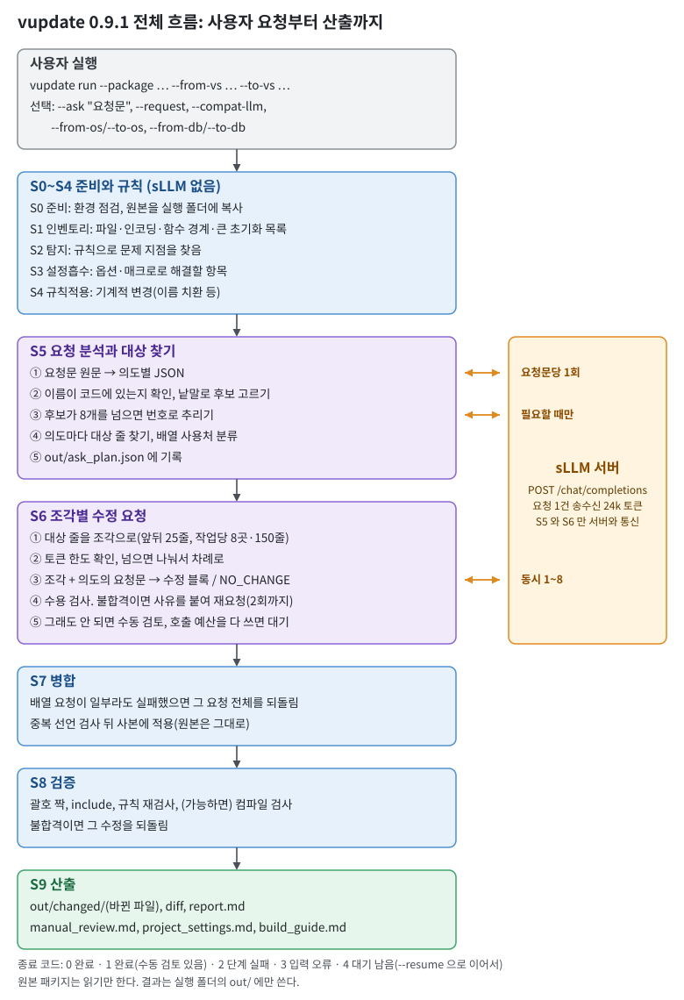

# 전체 흐름도(0.9.1)

| 항목 | 내용 |
|---|---|
| 읽는 순서 | 19 / 23 |
| 작성일 | 2026-11-25 |
| 대상 코드 | `vupdate.py` 0.9.1 |
| 그림 파일 | `19_전체_흐름도.svg`(브라우저로 열면 보인다) |

사용자가 `vupdate run`을 실행한 뒤 산출물이 나올 때까지의 흐름이다.

## 읽는 법

- 위에서 아래로 한 번 흐른다. 단계 이름(S0~S9)은 로그와 `--until`에 쓰는 이름과 같다.
- **sLLM 서버와 통신하는 단계는 S5와 S6뿐이다.** 그림의 주황색 화살표 세 곳이다.

| 화살표 | 무엇을 보내고 받는가 | 횟수 |
|---|---|---|
| S5 ① | 요청문 원문 → 의도별 JSON | 요청문(`--ask`)당 1회. 형식이 틀리면 1회 더 묻는다 |
| S5 ③ | 후보 이름 목록 → 남길 번호 | 낱말로 고른 후보가 8개를 넘을 때만 |
| S6 ③ | 코드 조각 + 의도의 요청문 → 수정 블록 또는 NO_CHANGE | 조각 수만큼. 동시에 1~8건 |

- `--ask`와 `--request`를 주지 않고 `--compat-llm`이 1(기본)이나 2면 S5·S6에서 서버를 부르지 않는다(이유가 로그와 보고서 첫머리에 적힌다). 환경 호환성 항목은 3단계에서만 서버에 간다.
- `--no-llm`이면 S0~S4와 S7~S9만 한다.
- 호출 예산(`--max-calls`)을 다 쓰면 남은 작업은 대기로 두고 종료 코드 4로 끝난다. `--resume 실행폴더`로 이어서 한다.

단계별로 무엇을 검사하고 언제 되돌리는지는 `18_추가_0.9.1.md` 4절, 요청문 분석의 JSON 양식은 `17_추가_0.9.0.md`에 있다.
